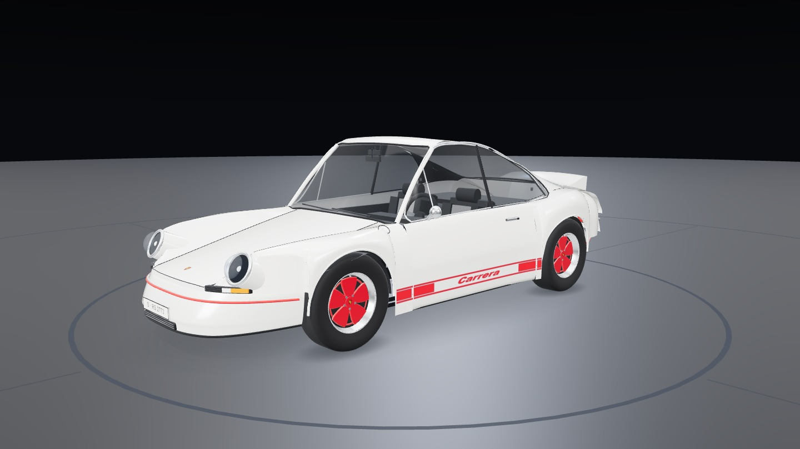
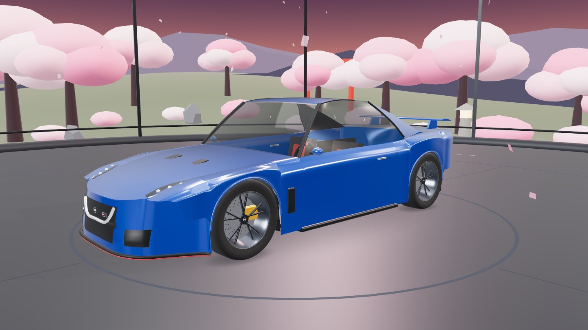
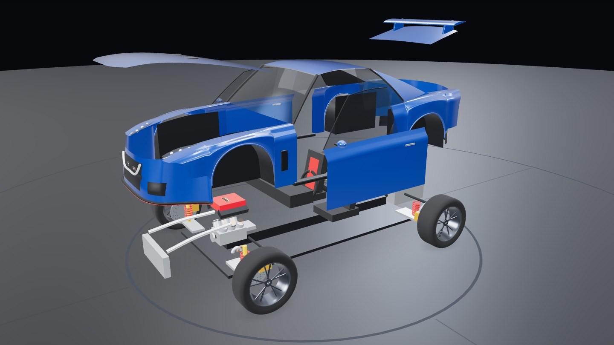

# Iconic Cars 3D Showroom

Take apart four cars in your browser. Orbit a car, move the teardown slider to separate its assemblies, or isolate the engine and step through its firing cycle. The models, studio environments, and textures are built procedurally in Three.js.

## Cars

| Car | Engine |
| --- | --- |
| 1973 Porsche 911 Carrera RS 2.7 | 2.7 L air-cooled flat-six |
| 1990 BMW M3 Sport Evolution (E30) | 2.5 L S14 inline-four |
| 2002 BMW M5 (E39) | 4.9 L S62 V8 |
| 2020 Nissan GT-R (R35) | 3.8 L VR38DETT twin-turbo V6 |

### Screenshots

| Porsche 911 Carrera RS 2.7 | BMW M3 Sport Evolution |
| --- | --- |
| [](docs/screenshots/porsche-911-rs.jpg) | [](docs/screenshots/bmw-m3-e30.jpg) |
| **BMW M5 (E39)** | **Nissan GT-R (R35)** |
| [](docs/screenshots/bmw-m5-e39.jpg) | [](docs/screenshots/nissan-gt-r.jpg) |
| **Nissan GT-R exploded teardown** | **BMW M5 X-ray** |
| [](docs/screenshots/gt-r-teardown.jpg) | [](docs/screenshots/m5-xray.jpg) |

## Build your own teardown showroom

Thanks to [elvarofficial](https://github.com/elvarofficial) for creating [teardown](https://github.com/elvarofficial/teardown), the Claude Code skill that inspired this showroom and its Codex skill.

Use [`$build-teardown-showroom`](.agents/skills/build-teardown-showroom/SKILL.md) in Codex with the car or mechanical assembly you want to build. The skill covers component modeling, exploded views, cutaways, and visual checks. The [four-car build prompt](docs/BUILD_PROMPT.md) is its worked example.

## Run locally

Use Node.js 22.12 or newer, Bun 1.4, and a browser with WebGL 2. The showroom runs entirely in the browser and requires no API key.

```sh
bun install --frozen-lockfile
bun run dev
```

Open `http://localhost:3000`. Drag to orbit and scroll or pinch to zoom. Press **H** to toggle the controls and **Space** to pause or resume engine playback. Add `?hide=1` to open with the controls hidden.

## Build and test

```sh
bun run lint
bun run test
bun run build
bun run preview
```

The build writes the static site to `dist/`. `lint` runs the TypeScript check. The tests cover displacement, crank and piston movement, firing order, teardown motion, and vehicle data.

## Media and source

- [Screenshot gallery](docs/screenshots/README.md) shows every car and the exploded and X-ray views.
- [Showroom demo MP4](iconic-cars-showroom-demo.mp4) is a 58-second, silent 1080p60 walkthrough. If the MP4 appears as a small pointer file, install Git LFS and run `git lfs pull --include="iconic-cars-showroom-demo.mp4"`. The app builds without downloading the video.

The React controls live in `src/components/TeardownHUD.tsx`. The vehicle specs, procedural models, and render loop live in `src/sim/`.

## License

The project source is available under the [Apache License 2.0](LICENSE). Vehicle names and marks belong to their respective owners. This project is independent of the vehicle manufacturers.
