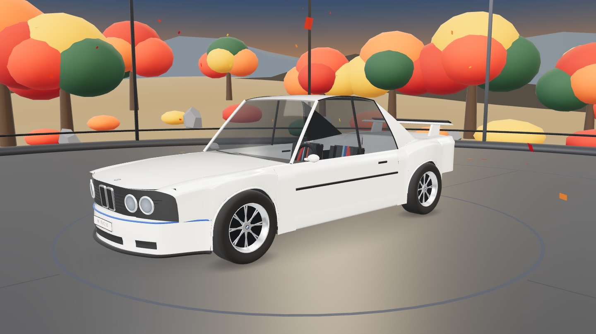
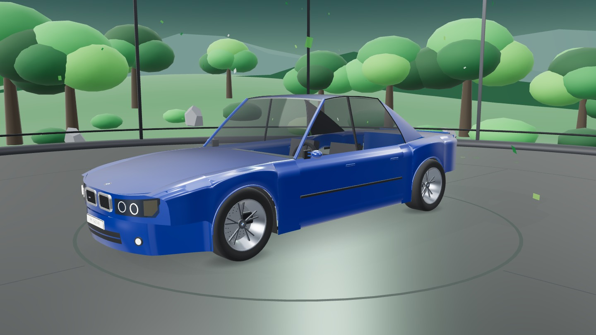
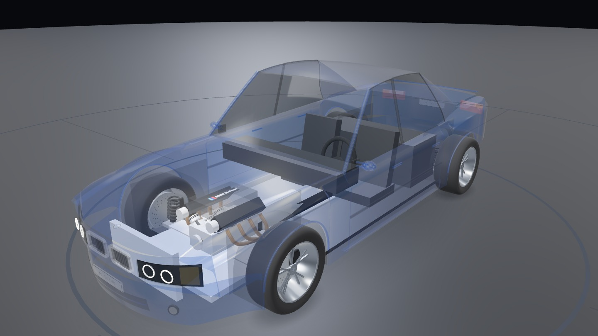

# Iconic Cars 3D Showroom

An interactive teardown showroom for four cars, running entirely in your browser. Orbit a car, drag the teardown slider to pull its assemblies apart, or isolate the engine and step through its firing cycle. Every model, studio environment, and texture is generated procedurally in Three.js, so there are no 3D asset downloads and no API keys.

[](docs/screenshots/porsche-911-rs.jpg)

## Contents

- [Features](#features)
- [Cars](#cars)
- [Screenshots](#screenshots)
- [Run locally](#run-locally)
- [Controls](#controls)
- [Build and test](#build-and-test)
- [Project structure](#project-structure)
- [Build your own teardown showroom](#build-your-own-teardown-showroom)
- [Media](#media)
- [License](#license)

## Features

- **Exploded teardown:** separate the body panels, wheels, chassis, drivetrain, and engine with a single slider.
- **Running engine:** play, pause, or step the crank in 15° increments, and change the RPM to watch pistons, firing order, and crank motion follow.
- **Subsystem isolation:** focus on the body, engine, transaxle, chassis, or wheels on their own.
- **Cutaway modes:** switch between Solid, X-Ray, and Section views.
- **Camera presets:** jump to hero, engine, chassis, front, and side shots for each car.
- **Backdrops and paint:** choose from Sakura, Canada, India, and Studio environments, and repaint each car in its own set of finishes.
- **Callout labels and auto tour:** toggle part labels, or let the showroom walk through the car for you.

## Cars

| Car | Engine |
| --- | --- |
| 1973 Porsche 911 Carrera RS 2.7 | 2.7 L air-cooled flat-six |
| 1990 BMW M3 Sport Evolution (E30) | 2.5 L S14 inline-four |
| 2002 BMW M5 (E39) | 4.9 L S62 V8 |
| 2020 Nissan GT-R (R35) | 3.8 L VR38DETT twin-turbo V6 |

## Screenshots

| Porsche 911 Carrera RS 2.7 | BMW M3 Sport Evolution |
| --- | --- |
| [](docs/screenshots/porsche-911-rs.jpg) | [](docs/screenshots/bmw-m3-e30.jpg) |
| **BMW M5 (E39)** | **Nissan GT-R (R35)** |
| [](docs/screenshots/bmw-m5-e39.jpg) | [](docs/screenshots/nissan-gt-r.jpg) |
| **Nissan GT-R exploded teardown** | **BMW M5 X-ray** |
| [](docs/screenshots/gt-r-teardown.jpg) | [](docs/screenshots/m5-xray.jpg) |

The [screenshot gallery](docs/screenshots/README.md) has every car plus the exploded and X-ray views.

## Run locally

**Requirements:** Node.js 22.12 or newer, Bun 1.4, and a browser with WebGL 2.

```sh
bun install --frozen-lockfile
bun run dev
```

Open <http://localhost:3000>.

## Controls

| Input | Action |
| --- | --- |
| Drag | Orbit the car |
| Scroll or pinch | Zoom |
| **H** | Show or hide the controls |
| **Space** | Pause or resume engine playback |
| `?hide=1` in the URL | Open with the controls hidden, useful for recordings and embeds |

## Build and test

```sh
bun run lint      # TypeScript type check
bun run test      # unit tests
bun run build     # static site written to dist/
bun run preview   # serve the production build
```

The tests cover displacement, crank and piston movement, firing order, teardown motion, and vehicle data. The production build is a static site, so `dist/` can be hosted on any static file host.

## Project structure

| Path | Contents |
| --- | --- |
| `src/components/TeardownHUD.tsx` | React controls overlay |
| `src/sim/specs.ts` | Vehicle specs, environments, paint finishes, and camera presets |
| `src/sim/sceneManager.ts` | Three.js scene setup and render loop |
| `src/sim/environments.ts`, `src/sim/textures.ts` | Procedural backdrops and textures |
| `src/sim/carCommon.ts` | Shared car-building helpers |
| `src/sim/porsche911*.ts`, `bmwE30M3.ts`, `bmwE39M5.ts`, `nissanR35GTR.ts` | Procedural models for each car |
| `docs/` | Screenshots and the four-car build prompt |
| `.agents/skills/` | The teardown showroom skill |

## Build your own teardown showroom

Thanks to [elvarofficial](https://github.com/elvarofficial) for creating [teardown](https://github.com/elvarofficial/teardown), the Claude Code skill that inspired this showroom and its Codex skill.

Use [`$build-teardown-showroom`](.agents/skills/build-teardown-showroom/SKILL.md) in Codex with the car or mechanical assembly you want to build. The skill covers component modeling, exploded views, cutaways, and visual checks. The [four-car build prompt](docs/BUILD_PROMPT.md) is its worked example.

## Media

[Showroom demo MP4](iconic-cars-showroom-demo.mp4) is a 58-second, silent 1080p60 walkthrough. If the MP4 appears as a small pointer file, install Git LFS and run `git lfs pull --include="iconic-cars-showroom-demo.mp4"`. The app builds without downloading the video.

## License

The project source is available under the [Apache License 2.0](LICENSE). Vehicle names and marks belong to their respective owners. This project is independent of the vehicle manufacturers.
